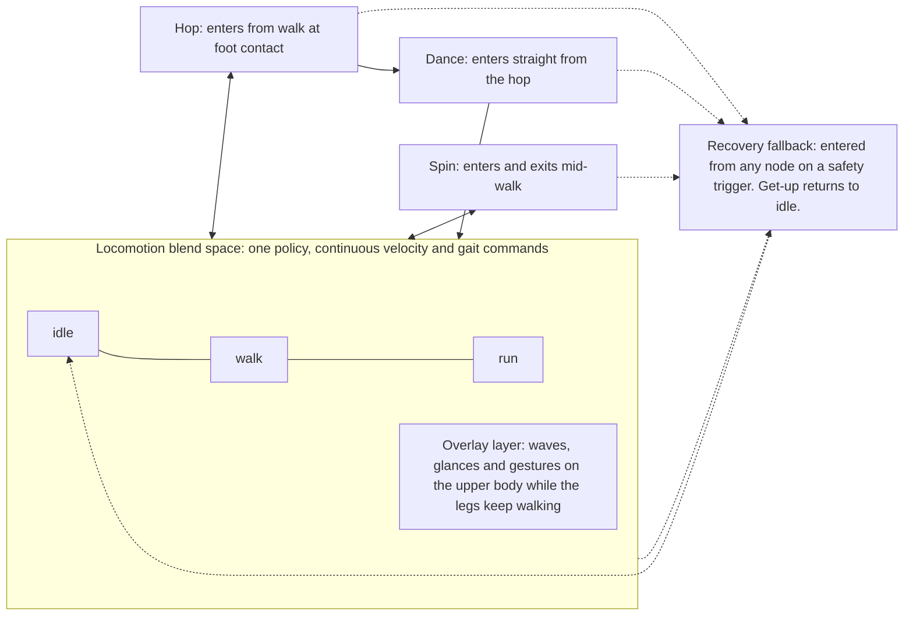

# Skill Library Framework

**Engineering framework proposal for the mechatronics, controls and software teams.**
One pipeline from CAD to show-ready behaviour, for every robot we build.

Behaviours are small, separate learned policies kept in a skill library. A motion graph composes them. Skills hand off directly to each other, with locomotion at the centre. Everything below is about making that shape cheap to extend and safe to run.

Slide deck version: https://claude.ai/artifact/Cd6MXoSwMMvX9wXacRf6Qe

---

## 1. Why

### 1.1 A monolithic policy turns every tweak into a retrain

When a behaviour lives inside reward terms, changing it means retraining everything that shares them.

- **Behaviour is encoded in rewards.** Gait shape, timing and style live in hand-tuned reward terms. One edit shifts every behaviour the policy learned.
- **New skills erase old ones.** Fine-tuning a locomotion policy for a new task can lose skills it already had. Standard continual-learning fixes do poorly.
- **Nothing can be tested in isolation.** Every retrain reopens validation of the whole robot, so a small request costs a full test cycle.

> This is the pain with one reinforcement learning policy rewarded to imitate example gaits. The behaviour is not stored anywhere you can edit. It is spread across reward terms and network weights. So "lift the feet a bit more" means a reward edit, a near-full retrain and a full re-validation. Published continual-learning work on legged robots confirms that fine-tuning for a new task tends to destroy existing skills. The framework exists to make that cost local to one skill.

*Source: continual reinforcement learning for legged locomotion, PMC11154561.*

### 1.2 The principle: edit motions, not reward functions

Training becomes one standard task: track a reference motion, with the same reward template and settings for every skill. Each new behaviour is a new clip, a new command or a new state.

| Kind of change | What it costs |
|---|---|
| New behaviour | A new clip and one small policy |
| Style tweak | A runtime command, no training |
| Fix | Retrain one skill, never the robot |

> Successful legged-robot teams standardised the learning problem. Every skill is trained the same way: follow this reference motion. The reward template and hyperparameters do not change between skills. That moves the creative work out of reward engineering and into motion authoring, which animators and engineers can both inspect.

---

## 2. Architecture

### 2.1 The stack has four layers with one job each

| Layer | Name | What it does | Decides |
|---|---|---|---|
| L1 | Operator and show layer | Puppeteer remote, show control or an autonomy planner. Issues intents and commands. | What happens |
| L2 | Animation engine and state machine | Layers loops, triggered clips and joystick modulation. Picks the active skill and owns every transition. | Which skill runs |
| L3 | Skill library | Learned policies at 50 Hz: locomotion, episodic clips and recovery. One package per skill. | How to move |
| L4 | Robot runtime | High-rate PD loop, actuator limits, state estimation and thermal monitoring. | Hardware stays safe |

**Side channel: show functions.** Eyes, lights, audio, jaw and antennas run on classical control. The animation engine schedules them. They are never part of training. Expression changes without retraining a single policy.

> Layer four upsamples policy targets into a fast PD loop. Published character robots run policies at 50 Hz and upsample to 600 Hz for the PD loop.

*Pattern from published character robots: arXiv 2501.05204 and 2512.16705.*

### 2.2 Every behaviour is one of four skill types

| Type | Examples | Description | Commands | Count |
|---|---|---|---|---|
| Locomotion | Idle, walk, run | One policy. Speed and gait are continuous, so idle to run is a blend. | Velocity, yaw rate, cadence, clearance, posture | One per robot |
| Overlay | Wave, glance, gesture | Upper-body clips layered on top of locomotion. | Upper-body targets, masked per limb | Many clips, no new policy |
| Episodic | Hop, dance, stunt | One clip, one policy, with tagged entry and exit windows. | A trigger, nothing else | One per clip |
| Recovery | Fall, get-up, abort | A fallback entered from any skill when a safety check trips. | None | A small fixed set |

> Published character robots used separate stand and walk policies switched at double support. We merge them so the robot never has to stop to change mode, at the cost of asking more of one policy. Overlays are fed to the locomotion policy as masked upper-body targets, so adding a gesture needs no new policy.

*Sources: arXiv 2501.05204 (skill types, layering); arXiv 2410.21229 (upper-body masking); arXiv 2610.01397 (abort).*

### 2.3 Skills form a motion graph, not a hub

Arrows are allowed transitions, each trained and tested. Speed changes are a blend, not a transition.

Stand is a fallback, never a waypoint.

> Forcing every skill through a standing pose makes a robot look mechanical: stand, walk, stand, run. Instead, idle, walk and run live inside one locomotion policy, so the animation engine blends between them the way a game engine blend space does. Episodic clips connect directly to locomotion and to each other through declared entry and exit windows. Recovery is the only state reachable from everywhere, and standing is just where get-up lands. The cost of this design is more transitions to train and test, which is why the graph lists its edges explicitly.

*Patterns: ramped clip blending, arXiv 2501.05204; upper-body command masking, HOVER, arXiv 2410.21229.*

### 2.4 Five transition rules make blending safe

| # | Rule | Why it matters |
|---|---|---|
| 1 | Every policy sees its previous two actions | Commands stay continuous across a hand-off, so the new policy does not jerk. |
| 2 | Hand off inside authored transition windows | Each clip names the gait phase, foot contact and speed range it can enter from. |
| 3 | Blend the reference, never the policy outputs | The engine ramps the incoming clip in, as animators cross-fade, so the target never jumps. |
| 4 | Train each skill on the end states of its neighbours | In simulation, a recovery policy that worked 63 of 64 times alone failed 64 of 64 behind a launch policy. |
| 5 | Only listed edges exist, and each one is tested | Ten skills could mean ninety transitions, so the graph is explicit and every edge is in the sim battery. |

> Rule three keeps blending at the reference level. The animation engine ramps the incoming clip in, as published character robots do with triggered clips, and the incoming policy is trained on blended starts. We never average two policies' motor outputs. Rule five controls cost: with direct hand-offs the number of possible transitions grows with the square of the skill count.

*Sources: arXiv 2501.05204; microduck-backflip experiment log; arXiv 2401.17583.*

### 2.5 Every skill ships as one versioned package

| Part | Contents | Owner |
|---|---|---|
| Reference motion | Clip at policy rate with tagged entry and exit windows | Animation |
| Policy | ONNX file at 50 Hz with a fixed observation and action spec | Controls and ML |
| Command spec | Runtime inputs and the ranges they were trained over | Controls and ML |
| Entry and exit | Allowed neighbours, transition windows and timeout | Software |
| Safety envelope | Torque, speed, thermal and fall limits it passed under | Mechatronics |
| Validation report | Sim battery, sim-to-sim and hardware success ratios | All teams |
| Version record | Robot model hash, actuator model version, config, seed | Software |

A package with a missing part cannot be loaded by the state machine.

> The version record ties the package to the exact robot model and actuator model it was trained against, so we can tell immediately which skills need retraining when hardware changes. Open-source humanoid deploy code ships one policy file and one reference clip per mimic state.

---

## 3. Pipeline

### 3.1 A skill moves through six gated stages

| Stage | Owner | Work | Gate |
|---|---|---|---|
| 1. Author | Animation | Animation tools, mocap, video or keyframes | Plays cleanly on the robot model |
| 2. Retarget and check | Animation | IK retarget to the robot's proportions | No ground penetration, self-collision or limit breach |
| 3. Preview train | Controls and ML | About 30 minutes on the fixed recipe | Nominal behaviour appears |
| 4. Full train | Controls and ML | Adaptive sampling and full randomization | Strict multi-seed sim battery passes |
| 5. Sim-to-sim | Software | Same ONNX file in a second simulator, through deploy code | Behaviour matches training |
| 6. Hardware and release | All teams | Gantry first, then free on mats | Stated success ratio, then library entry |

> Failing a gate sends the skill back one stage. Most failures are fixed in stages one and two, by fixing the clip, not by changing rewards. Published retargeting work showed that bad retargets alone dropped tracking success from 100 percent to zero on two dances. Published character-robot work reports about 1,500 iterations, roughly 30 minutes, are enough to see the nominal behaviour before a full run of about 2 days on one RTX 4090.

### 3.2 Each new robot is onboarded once, by mechatronics

1. One simulation model (MJCF) for training and sim-to-sim.
2. Weigh real parts and override the CAD masses.
3. Bench-identify each actuator: friction, rotor inertia, torque-speed curve, heating.
4. Calibration jig for the zero pose and the IMU mount.
5. PD gains from reflected inertia: kp = I·ω², kd = 2·I·ζ·ω, with ω = 2π·10 Hz and ζ = 2.
6. Trajectory-optimize the hardest skill against motor limits.

**Exit gate:** simulated step and chirp responses match the bench data.

**Why this comes first.** Policies trained on idealised actuator models could not take a single step on real hardware. Setting rotor inertia to zero in simulation causes over-swing and self-collision in dynamic motion.

*Sources: arXiv 1901.08652; arXiv 2508.08241; Open Duck Mini and ToddlerBot sim-to-real documentation.*

### 3.3 One training recipe covers every skill

**Reward template.** Each tracking term is the mean error over tracked bodies, mapped through exp(−error/σ²).

| Term | Form | Weight |
|---|---|---|
| Body position | exp tracking, σ 0.3 | 1.0 |
| Body orientation | exp tracking, σ 0.4 | 1.0 |
| Linear velocity | exp tracking, σ 1.0 | 1.0 |
| Angular velocity | exp tracking, σ 3.14 | 1.0 |
| Anchor position | exp tracking, optional | 0.5 |
| Anchor orientation | exp tracking, optional | 0.5 |
| Action rate | penalty | −0.1 |
| Joint limits | penalty | −10 |
| Self-contact | penalty | −0.1 |

**Also fixed for every skill:**

- **Termination:** 0.25 m height or 0.8 rad orientation error.
- **Adaptive sampling:** 1 s bins weighted by recent failure rate.
- **Randomization:** friction, mass, motor strength, latency, sensor noise.
- **Algorithm:** PPO, thousands of parallel environments on one GPU.

**Tune once per robot. Then freeze.**

> Adaptive sampling is the ingredient that makes hard clips converge: episodes start more often just before the segments where the policy keeps failing. In the paper's ablation, three of four hard motions never converged without it. We tune once per robot, for example loosening termination for aerial clips, and then freeze.

*Starting values from BeyondMimic, arXiv 2508.08241, Table S1 and section S1.*

---

## 4. Operating

### 4.1 Most changes never touch the training recipe

| Change requested | Tool | Retrain cost |
|---|---|---|
| Clearance, cadence, height | Command input trained over a range | None, set at runtime |
| Balance of competing goals | Reward weights as policy inputs | None, becomes a slider |
| New dance, gesture or stunt | New clip, new episodic policy, new state | That skill only |
| Local fix to one skill | Frozen policy plus residual, or warm start | Short; old version kept |
| Eyes, sound, timing | Animation engine layers, show functions | None |
| Failure seen on hardware | Recreate in sim, add to tests, retrain | One skill plus regression |

A change to the reward template is a rare, versioned event that triggers a full regression run.

*Sources: arXiv 2212.03238; arXiv 2505.23708; arXiv 2510.05070; Boston Dynamics Spot RL blog.*

### 4.2 Four teams own clear interfaces

| Team | Owns | Delivers |
|---|---|---|
| Mechatronics | Robot model, actuator bench ID, calibration, safety envelope, padding and gantry | Validated sim model and actuator model version |
| Controls and ML | Training recipe, per-skill training, sim-to-sim checks, distillation | Skill packages with validation reports |
| Software and runtime | Robot runtime, state machine and animation engine, logging and release tools, regression suite | Deployable library builds |
| Animation and character | Reference clips, retarget checks, show functions, performance timing | Clips that pass the stage 2 gate |

The skill package in section 2.5 is the hand-off format between all four teams.

### 4.3 Every release passes the same five gates

| Gate | Name | Criterion |
|---|---|---|
| G1 | Sim battery | Multi-seed, same thresholds as training |
| G2 | Sim-to-sim | Second simulator, real deploy code |
| G3 | Gantry | Support rig, every joint logged |
| G4 | Free on mats | Padded robot and floor, ratio counted |
| G5 | Library release | Full regression, then a tagged build |

**Regression rules:**

- Every release re-runs every skill's sim battery.
- Each failure seen on hardware becomes a permanent test case.
- Results are ratios, for example 47 of 50, never "works".

Benchmark: one production legged-robot team runs a test fleet for over 2,000 hours a week before shipping.

> Open experiment logs show how a curriculum can report 27 of 32 successes while a strict evaluator reports 5 of 32. That is why gate one uses exactly the same thresholds as training.

*Sources: Boston Dynamics Spot RL blog; microduck-backflip evaluation practice.*

---

## 5. Plan

### 5.1 A proposed 16-week plan to a first skill library

Durations are planning estimates to calibrate on the first robot.

| Workstream | Owner | Weeks |
|---|---|---|
| Model and bench ID | Mechatronics | 1–4 |
| Calibration and runtime | Software | 3–6 |
| Locomotion policy | Controls and ML | 4–8 |
| Sim-to-sim and gantry walk | All teams | 7–10 |
| Recovery and get-up | Controls and ML | 9–12 |
| First episodic clips | Animation, Controls and ML | 8–14 |
| Library release 1 | Software | 14–16 |

> Reuse benchmark: a press report says a second published character robot took about 4 months, against about a year for the first, because the tooling already existed.

### 5.2 A proposed one-week cycle for each new skill

| Day | Step | Work |
|---|---|---|
| 1 | Author and check | Clip, retarget, stage 2 checks |
| 1 | Preview | Short run, review the motion |
| 2–3 | Full training | Unattended, one GPU |
| 4 | Sim gates | Battery and sim-to-sim |
| 5 | Hardware | Gantry, mats, release |

| Figure | Meaning |
|---|---|
| 30 min | To preview a skill on the fixed recipe |
| ≈2 days | For a full run on one RTX 4090 |
| 0 | Other skills retrained when one is added |

*Day plan proposed; preview and full-run times from published character robots, arXiv 2501.05204 and 2512.16705.*

### 5.3 The toolchain is open and built around MuJoCo

| Layer | Tool | Why |
|---|---|---|
| Simulation, training | mjlab on MuJoCo Warp, rsl_rl PPO | Isaac Lab-style API, ships a tracking task |
| Tracking recipe | BeyondMimic | Fixed rewards, adaptive sampling, PD rules |
| Retargeting | GMR | IK retargeting from the robot's model file |
| Actuator ID | BAM plus bench rigs | Friction, inertia, back-EMF into the model |
| Authoring | Maya or Blender, mocap, gait tool | Animators edit clips, not rewards |
| Deployment | ONNX runtime, motion graph config | One policy file per skill |
| Reference code | unitree_rl_lab, booster_train | Production state machines, per-skill policies |
| Records | Append-only experiment log | Hypothesis, command, evidence, decision |

Isaac Lab is a supported alternative. One MuJoCo model file stays the single source of truth.

### 5.4 We adopt the framework in three phases

| Phase | Focus | Work |
|---|---|---|
| 1. First robot | Foundation | Onboard the robot; freeze the training recipe; locomotion and recovery skills; motion graph runtime v1 |
| 2. Skills at pace | Library growth | Episodic clips on the weekly cycle; upper-body overlays; residual fixes with old versions kept; regression suite in CI |
| 3. When data allows | Consolidation | Distil specialists into one student policy; move to a general tracker that can follow any blended reference |

**The general tracker is earned, not assumed.** Published ones used about 700 hours of motion capture and thousands of GPU-hours, and they still lose balance on very dynamic motion.

*Sources: SONIC, arXiv 2511.07820; distillation, arXiv 2309.05665 and 2602.23843.*

### 5.5 Six known risks and how we contain them

| Risk | Symptom | Containment |
|---|---|---|
| Wrong actuator model | Over-swing, falls on hardware | Bench ID gate, torque-speed limits, delay randomization |
| Reward hacking | Passes in sim through a loophole | Hard state gates; watch every reward term |
| Train and test mismatch | Pass rate collapses when tested strictly | Identical thresholds; multi-seed batteries |
| Untested edges | Works alone, fails after a neighbour | Explicit edges; train on neighbour end states |
| Thermal drift | Falls increase over a session | Temperature input, cool-downs, torque margin |
| Hardware damage | Cracked housings after falls | Padding, gantry, protective-fall policy |

> An unprotected humanoid was damaged after one or two dynamic falls, and 12 mm impact padding cut peak impact force by 87 percent. A published character robot now feeds actuator temperature to its policy.

*Sources: arXiv 2602.23843; 2512.16705; 2502.00893; 2601.02857; microduck-backflip experiment log.*

### 5.6 The framework follows published practice

| Source | What we take from it |
|---|---|
| Bipedal robotic character, arXiv 2501.05204 | Skill types, animation engine, per-clip policies |
| Olaf character robot, arXiv 2512.16705 | Thermal and impact-noise terms, 50 Hz policies |
| BeyondMimic, arXiv 2508.08241 | Fixed tracking recipe, adaptive sampling, PD gains |
| HOVER, arXiv 2410.21229 | Upper- and lower-body command masking |
| Walk These Ways, arXiv 2212.03238 | Gait features as runtime commands |
| Agile But Safe, arXiv 2401.17583 | Learned safety value for recovery hand-off |
| ANYmal actuator model, arXiv 1901.08652 | Actuator fidelity decides sim-to-real transfer |
| Spot learned locomotion, Boston Dynamics | Field failures recreated in sim; fleet testing |

> The two places we go beyond published character robots are the merged locomotion policy and direct skill-to-skill hand-offs. Both are design choices to validate on the first robot.

### 5.7 Decisions we need from each team

| Team | Decision |
|---|---|
| Mechatronics | Fund bench-ID rigs and agree the actuator model format. |
| Controls and ML | Freeze the training recipe after the first robot. |
| Software | Own the skill package format and the motion graph runtime. |
| Animation | Adopt tagged transition windows and the stage 2 checks. |
| All teams | Agree gate thresholds and a release cadence of [__]. |

Full research report with links: "Bipedal robot training and flips" (`~/src/RobotResearch/reports/`).
